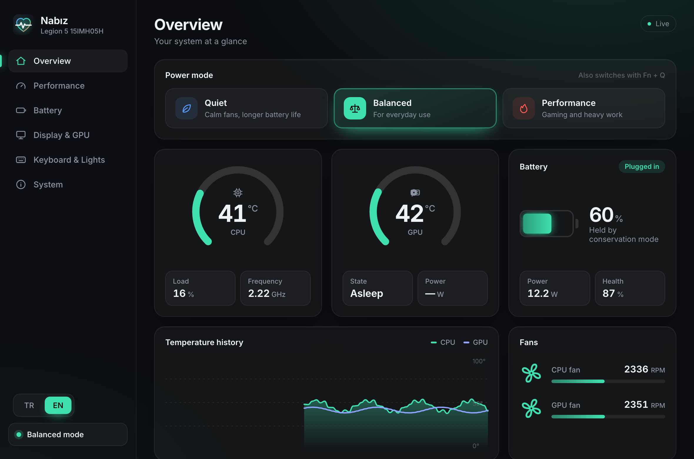
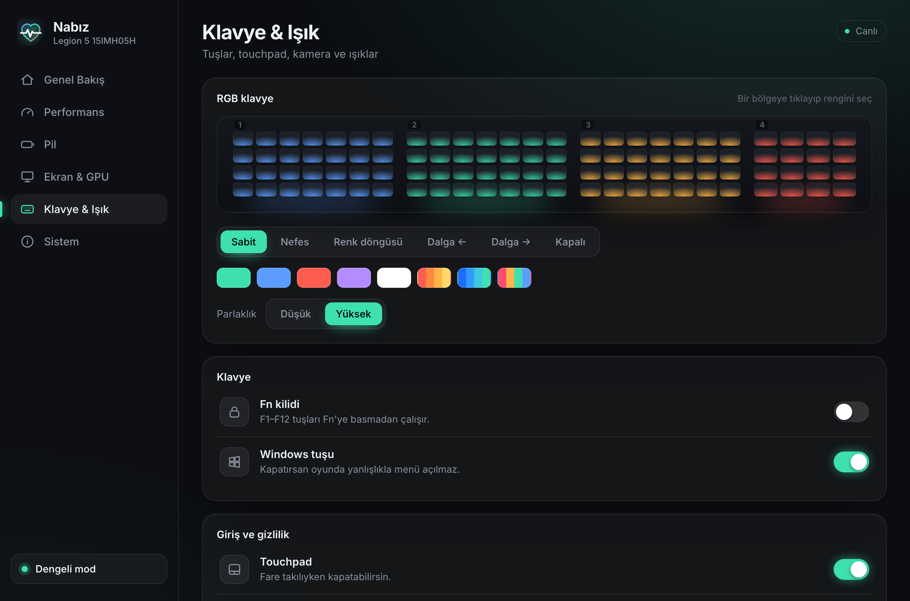
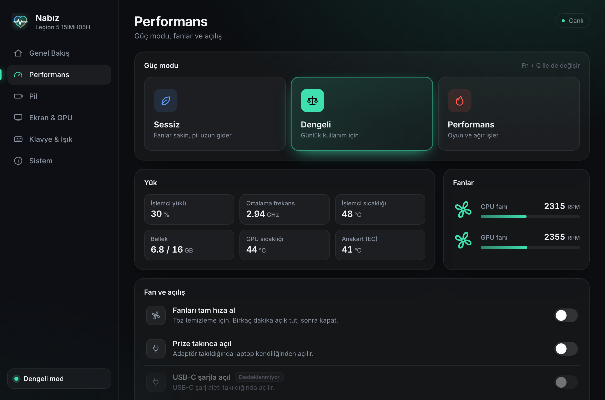
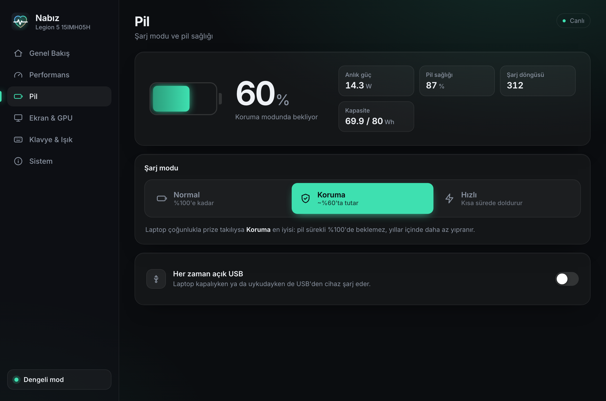
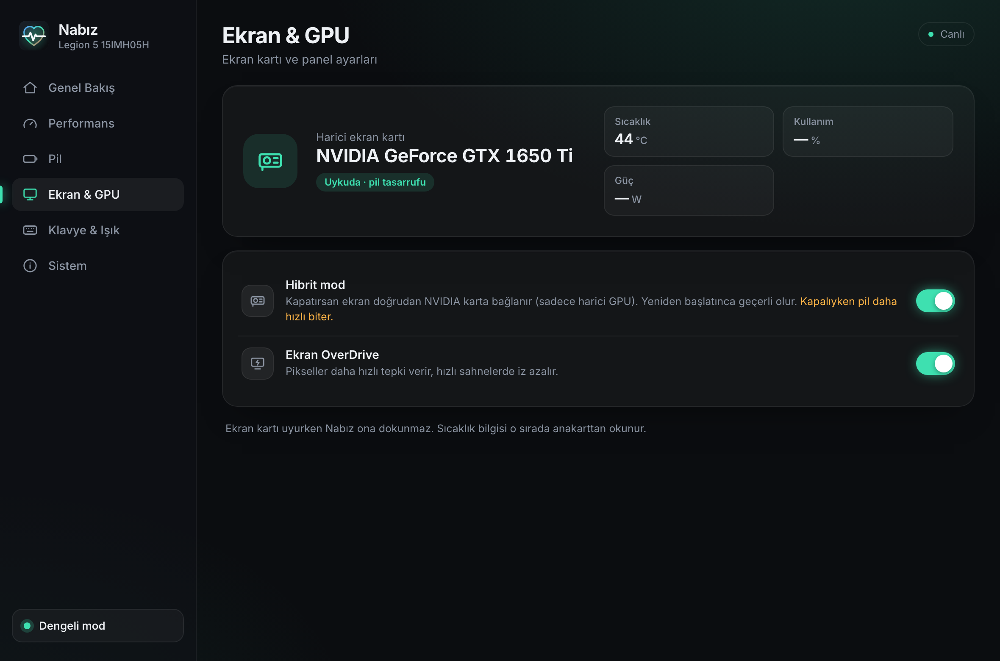
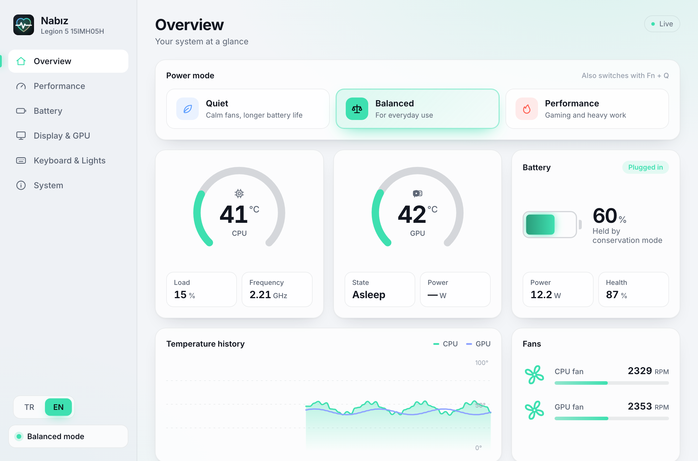

<p align="center">
  
</p>

<h1 align="center">Nabız</h1>

<p align="center">
  <b>A modern, open-source control center for Linux laptops.</b><br>
  Power modes, live sensors, battery care and hardware toggles in one app, with the deepest support for Lenovo Legion and IdeaPad.
</p>

<p align="center">
  <b>English</b> · <a href="README.tr.md">Türkçe</a>
</p>

<p align="center">
  
</p>

> *Nabız* (pronounced "nah-buhz") is Turkish for *pulse*. The app keeps a finger on your laptop's pulse.

## Why this exists

Laptop makers ship control apps for Windows: power modes, battery care, keyboard lighting, the Windows-key lock and so on. On Linux there is usually no official equivalent. The hardware is still there, but its controls are spread across sysfs files, kernel modules and several single-purpose tools.

Nabız started on a Lenovo Legion after moving from Windows to Linux, and grew into a general control center for Linux laptops:

- **Works on any Linux laptop.** Monitoring, power modes, camera, touchpad and Windows-key controls use generic kernel interfaces, so they work regardless of brand.
- **Works out of the box** with the drivers that already ship in the Linux kernel. No extra kernel module is needed for the core features.
- **Gets more capable on its own** if the community [`legion_laptop`](https://github.com/johnfanv2/LenovoLegionLinux) driver is installed: real fan speeds, display OverDrive, hybrid/dGPU mode.
- **Only shows what your laptop can do.** Every feature is detected at runtime. Unsupported controls are marked as such, not left as switches that silently do nothing.
- **Checks every write.** After each change Nabız reads the value back, so a firmware that ignores a request shows up as an error instead of a fake "on".

## Features

| Area | What you get |
|---|---|
| **Overview** | Live CPU/GPU temperature, fan speeds, CPU load and frequency, memory, battery level and power draw, temperature history |
| **Power mode** | Quiet / Balanced / Performance (+ Custom when supported), synced with <kbd>Fn</kbd>+<kbd>Q</kbd>. The accent color follows the mode |
| **Battery** | Normal, Conservation (holds around 60%) and Rapid charge (mutually exclusive), always-on USB charging, health and cycle count |
| **Display & GPU** | Hybrid mode (dGPU only when off), display OverDrive. The NVIDIA GPU is never woken up just to read its stats |
| **Keyboard & lights** | 4-zone RGB with static, breathing, color cycle and wave effects, presets, brightness and speed. Fn lock, Windows-key lock, touchpad and camera on/off |
| **System** | Model, BIOS, kernel and which drivers are active, with a copy-paste command for the optional driver |
| **Language** | English and Turkish. Follows your system language; switch any time from the sidebar |

<p align="center">
  
  
</p>
<p align="center">
  
  
</p>

A light theme follows your desktop setting:

<p align="center"></p>

### Driver-free fallbacks

Some toggles normally depend on the out-of-tree Legion driver. Nabız has its own fallbacks for them, so they work without it:

- **Camera:** disconnects the built-in USB camera from the system (`authorized`). Apps cannot see it until you turn it back on.
- **Touchpad:** inhibits the input device at kernel level, so it works on any desktop, not only GNOME.
- **Windows key:** remaps the Meta keys of the built-in keyboard to nothing. A reboot restores the original keymap.
- **Rapid charge:** uses the battery's `charge_types` file on newer kernels.

## How it compares

Nabız stands on the work of other projects and does not try to replace all of them.

| Project | Platform | What it is |
|---|---|---|
| **Nabız** | Linux | One modern app for everyday laptop controls on any brand, with deep Lenovo support. Core features work with the stock kernel; uses `legion_laptop` when present. Fan curve editor not available yet (planned) |
| [LenovoLegionLinux](https://github.com/johnfanv2/LenovoLegionLinux) | Linux | The kernel driver plus a Python GUI and a daemon. The most complete feature set, including fan curves; most features need its out-of-tree module. Nabız uses this driver when it is installed |
| [Lenovo Legion Toolkit](https://github.com/BartoszCichecki/LenovoLegionToolkit) | Windows | A lightweight alternative to the vendor app on Windows. Archived in 2025 |
| [L5P-Keyboard-RGB](https://github.com/4JX/L5P-Keyboard-RGB) | Linux, Windows | Keyboard lighting only, with many effects |
| Vendor app | Windows | Closed source, no Linux version |

## Compatibility

Nabız checks what your laptop supports at startup and only shows what works. Brand-specific hints and drivers appear only on matching hardware.

| Feature | Any Linux laptop | Lenovo IdeaPad / Yoga | Lenovo Legion |
|---|:-:|:-:|:-:|
| CPU temperature, load, memory, battery health, NVIDIA GPU | ✅ | ✅ | ✅ |
| Power modes (`platform_profile`) | ✅ on most recent laptops | ✅ | ✅ |
| Camera, touchpad, Windows-key toggles | ✅ | ✅ | ✅ |
| Battery conservation, Fn lock, always-on USB | | ✅ | ✅ |
| Rapid charge | where the battery exposes it | ✅ | ✅ |
| 4-zone RGB keyboard | | | ✅ (ITE `048d:c955`–`c995`) |
| Fan speeds, OverDrive, hybrid mode | | | ✅ with `legion_laptop` |

- **Tested on:** Legion 5 15ARH05 (AMD Ryzen 7 4800H, GTX 1650 Ti), CachyOS, GNOME on Wayland, kernel 7.3.
- Other machines have not been tested yet; the table reflects which kernel interfaces each feature uses. Reports are very welcome: please open an issue with the output of `nabiz dump`.

## Install

Nabız currently builds from source. These steps are for Arch Linux and Arch-based distributions such as CachyOS, EndeavourOS and Manjaro:

```bash
git clone https://github.com/OguzhanKodal/nabiz.git
cd nabiz
bash packaging/install.sh
```

The script installs the build dependencies (`rust`, `nodejs`, `npm`, `webkit2gtk-4.1`, `polkit`), builds the app and installs:

- the binary to `/usr/bin/nabiz`,
- a polkit policy,
- a udev rule for the RGB keyboard,
- the desktop entry and icons.

On other distributions, install the same dependencies and run `npm install && npm run tauri build -- --no-bundle`, then `sudo bash packaging/install-files.sh`.

### Optional: Legion driver

On Lenovo Legion laptops, install the community driver from its current source for real fan speeds, OverDrive and hybrid mode:

```bash
sudo pacman -S --needed dkms git
git clone --depth 1 https://github.com/johnfanv2/LenovoLegionLinux.git
cd LenovoLegionLinux/kernel_module
sudo make dkms
echo 'options legion_laptop enable_platformprofile=0' | sudo tee /etc/modprobe.d/legion_laptop.conf
sudo modprobe legion_laptop
```

`enable_platformprofile=0` keeps power-mode handling in the kernel's own `lenovo-wmi-gamezone` driver, so the two drivers don't conflict. Packaged versions in some repositories can be too old for recent kernels.

## Security model

- Reading sensors and settings runs as your normal user.
- When a write needs root, the same binary is started through `pkexec nabiz helper …`. The helper accepts only the settings on a fixed allow-list (`src-tauri/src/hw.rs`) with validated values, and never takes a file path from outside.
- The polkit policy lets the active local user change these settings without a password. Remote or inactive sessions still need authentication.
- The RGB keyboard is written through `hidraw`. A udev rule grants access to the logged-in user only.

## Roadmap

- **v0.2:** fan curve editor, automatic power mode on AC/battery, tray icon
- Prebuilt packages (AUR, GitHub Releases)
- Power limits on supported models

## Development

```bash
npm install
npm run dev                      # UI only, in the browser with mock data (http://localhost:1420)
npm run tauri dev                # desktop app; demo mode automatically outside Linux
NABIZ_DEMO=1 npm run tauri dev   # demo mode on Linux
nabiz dump                       # print detected hardware and sensors as JSON
```

Built with [Tauri 2](https://tauri.app) (Rust) and plain TypeScript. No UI framework.

## Credits

- [LenovoLegionLinux](https://github.com/johnfanv2/LenovoLegionLinux) by johnfanv2: the kernel driver and the sysfs layout Nabız reads.
- [L5P-Keyboard-RGB](https://github.com/4JX/L5P-Keyboard-RGB): reference for the 4-zone keyboard protocol.
- [Lenovo Legion Toolkit](https://github.com/BartoszCichecki/LenovoLegionToolkit): reference for the feature list.

## Disclaimer

Nabız is an independent community project. It is not affiliated with, endorsed by or sponsored by Lenovo or any other laptop maker. "Lenovo", "Legion" and other brand names are trademarks of their owners and are used here only to describe compatible hardware. Changing hardware settings is at your own risk.

## License

[GPL-3.0-or-later](LICENSE)
