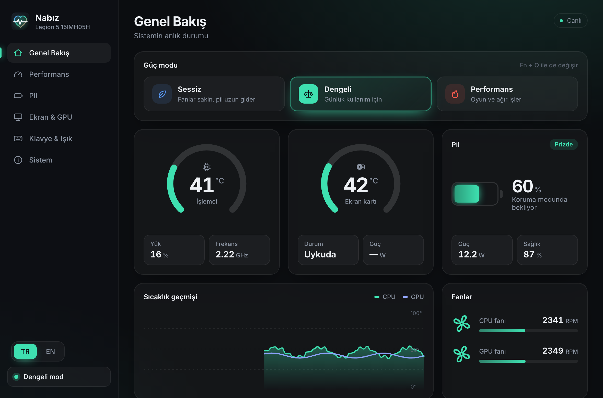
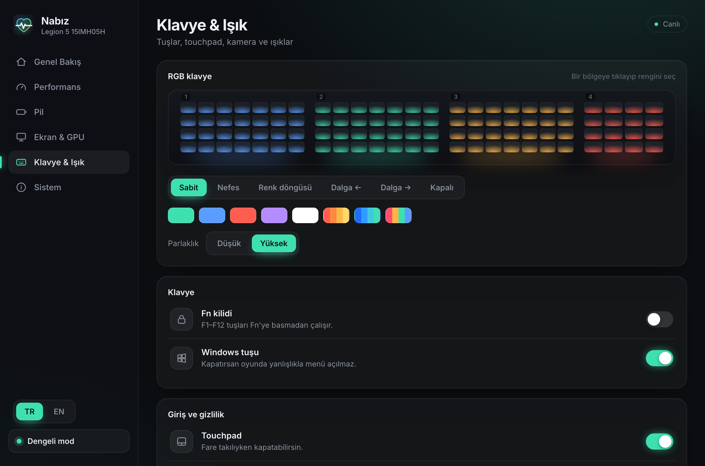
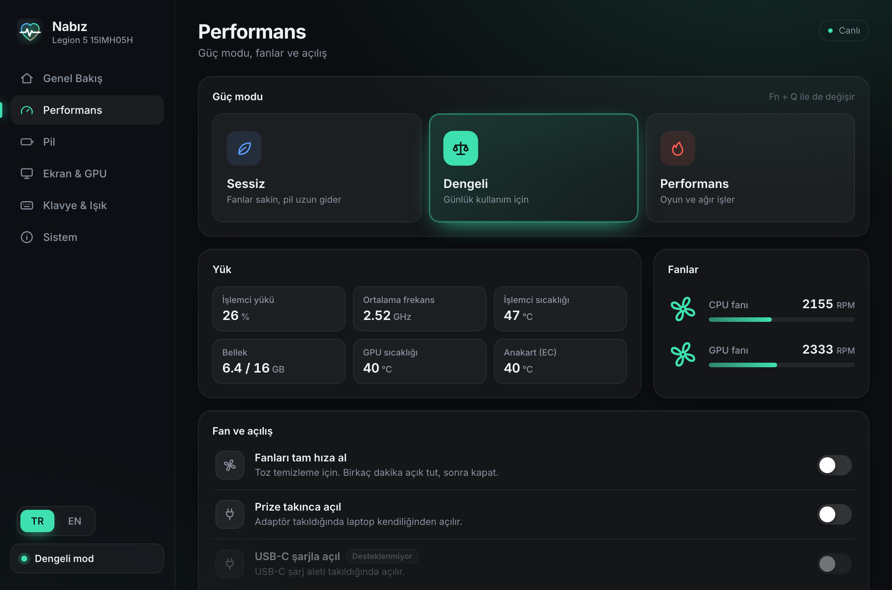
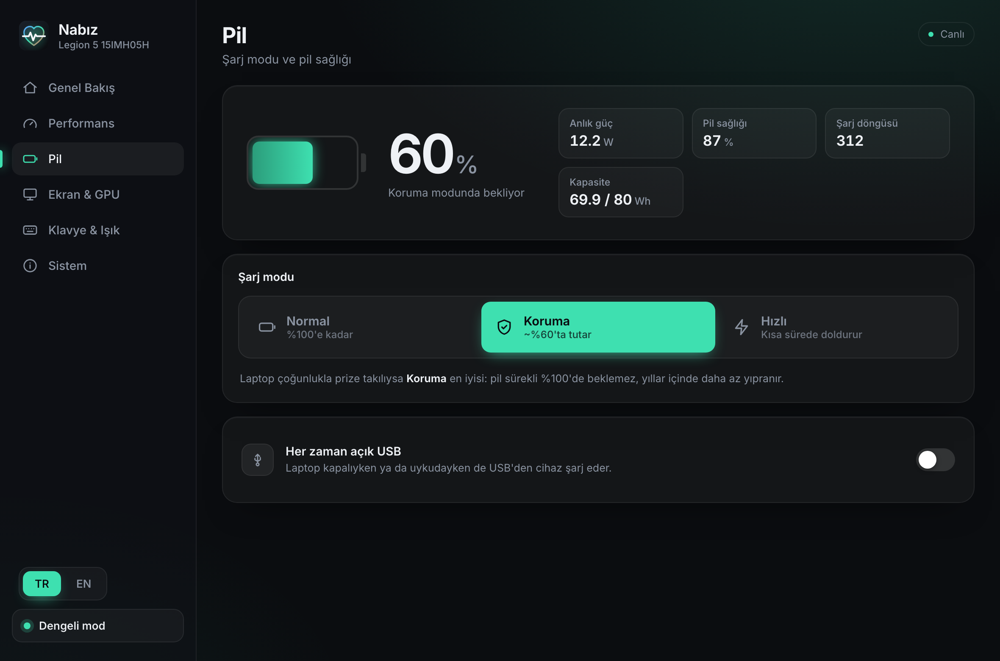
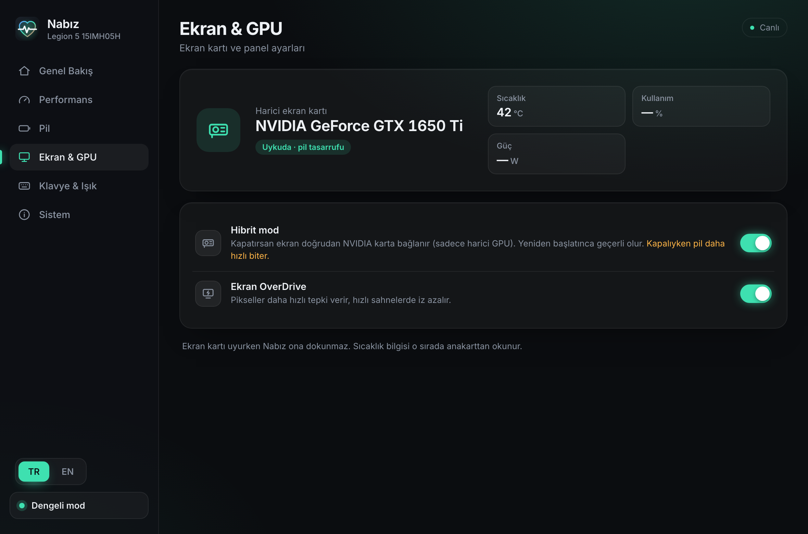
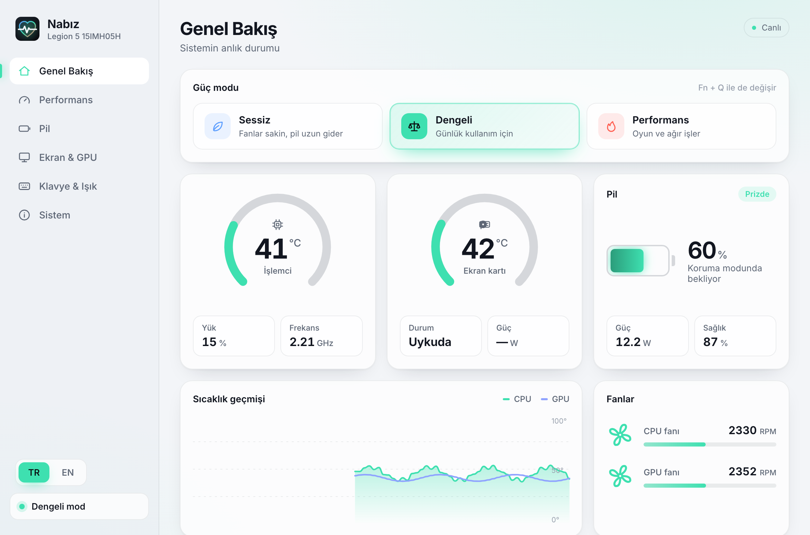

<p align="center">
  
</p>

<h1 align="center">Nabız</h1>

<p align="center">
  <b>Linux laptoplar için modern, açık kaynak bir kontrol merkezi.</b><br>
  Güç modları, canlı sensörler, pil bakımı ve donanım ayarları tek uygulamada. En kapsamlı destek Lenovo Legion ve IdeaPad'de.
</p>

<p align="center">
  <a href="README.md">English</a> · <b>Türkçe</b>
</p>

<p align="center">
  
</p>

## Neden yaptık

Laptop üreticileri Windows için kontrol uygulamaları sunuyor: güç modu, pil bakımı, klavye ışığı, Windows tuşu kilidi gibi. Linux'ta çoğu zaman bunun resmi bir karşılığı yok. Donanım yerinde duruyor ama ayarları sysfs dosyalarına, çekirdek modüllerine ve tek işe odaklanmış farklı araçlara dağılmış durumda.

Nabız, Windows'tan Linux'a geçtikten sonra bir Lenovo Legion'da başladı ve Linux laptoplar için genel bir kontrol merkezine dönüştü:

- **Her Linux laptopta çalışır.** İzleme, güç modları, kamera, touchpad ve Windows tuşu ayarları Linux'un ortak arayüzlerini kullanır, marka fark etmez.
- **Kurar kurmaz çalışır.** Linux çekirdeğiyle zaten gelen sürücüleri kullanır. Temel özellikler için ek çekirdek modülü gerekmez.
- **Kendiliğinden genişler.** Topluluğun geliştirdiği [`legion_laptop`](https://github.com/johnfanv2/LenovoLegionLinux) sürücüsü kuruluysa gerçek fan devri, ekran OverDrive ve hibrit/harici GPU modu da açılır.
- **Yalnızca laptopunun yapabildiğini gösterir.** Her özellik çalışırken tespit edilir. Desteklenmeyen ayar "Desteklenmiyor" diye işaretlenir. Hiçbir şey yapmayan sahte düğme bırakılmaz.
- **Her değişikliği doğrular.** Her yazmadan sonra değeri geri okur. Firmware isteği yok sayarsa sahte bir "açık" görmezsin, hata görürsün.

## Özellikler

| Bölüm | İçerik |
|---|---|
| **Genel bakış** | Canlı CPU/GPU sıcaklığı, fan devri, CPU yükü ve frekansı, bellek, pil seviyesi ve güç çekişi, sıcaklık geçmişi |
| **Güç modu** | Sessiz / Dengeli / Performans (destekleniyorsa Özel), <kbd>Fn</kbd>+<kbd>Q</kbd> ile senkron. Arayüz rengi moda göre değişir |
| **Pil** | Normal, Koruma (yaklaşık %60'ta tutar) ve Hızlı şarj (aynı anda açılmaz), her zaman açık USB şarjı, pil sağlığı ve döngü sayısı |
| **Ekran & GPU** | Hibrit mod (kapalıyken yalnızca harici GPU), ekran OverDrive. NVIDIA kart sırf bilgi okumak için uyandırılmaz |
| **Klavye & ışık** | 4 bölgeli RGB: sabit, nefes, renk döngüsü ve dalga efektleri, hazır temalar, parlaklık ve hız. Fn kilidi, Windows tuşu kilidi, touchpad ve kamera aç/kapa |
| **Sistem** | Model, BIOS, çekirdek ve hangi sürücülerin yüklü olduğu. İsteğe bağlı sürücü için kopyalanabilir komut |
| **Dil** | Türkçe ve İngilizce. Sistem dilini takip eder, yan menüden istediğin an değiştirilebilir |

<p align="center">
  
  
</p>
<p align="center">
  
  
</p>

Açık tema, masaüstü ayarını takip eder:

<p align="center"></p>

### Sürücüsüz çalışan ayarlar

Bazı ayarlar normalde çekirdeğe ayrıca kurulan Legion sürücüsüne bağlıdır. Nabız bunlar için kendi yollarını kullanır, sürücü olmadan da çalışırlar:

- **Kamera:** Dahili USB kamerayı sistemden ayırır (`authorized`). Geri açana kadar hiçbir uygulama göremez.
- **Touchpad:** Aygıtı çekirdek düzeyinde durdurur. Yalnızca GNOME'da değil, her masaüstünde çalışır.
- **Windows tuşu:** Dahili klavyedeki Meta tuşlarını boşa eşler. Yeniden başlatınca eski haline döner.
- **Hızlı şarj:** Yeni çekirdeklerde pilin `charge_types` dosyasını kullanır.

## Benzerlerinden farkı

Nabız başka projelerin emeği üzerine kurulu. Hepsinin yerini almaya çalışmıyor.

| Proje | Platform | Ne |
|---|---|---|
| **Nabız** | Linux | Her markada günlük laptop ayarları için tek, modern uygulama; Lenovo'da en kapsamlı. Temel özellikler standart çekirdekle çalışır, `legion_laptop` varsa onu da kullanır. Fan eğrisi düzenleyici henüz yok (planlandı) |
| [LenovoLegionLinux](https://github.com/johnfanv2/LenovoLegionLinux) | Linux | Çekirdek sürücüsü, Python arayüzü ve arka plan servisi. Fan eğrileri dahil en kapsamlı özellik seti. Özelliklerin çoğu çekirdeğe ayrıca kurulan modülünü ister. Nabız bu sürücü kuruluysa onu kullanır |
| [Lenovo Legion Toolkit](https://github.com/BartoszCichecki/LenovoLegionToolkit) | Windows | Windows'ta üretici uygulamasına hafif bir alternatif. 2025'te arşivlendi |
| [L5P-Keyboard-RGB](https://github.com/4JX/L5P-Keyboard-RGB) | Linux, Windows | Yalnızca klavye ışığı, çok sayıda efekt |
| Üretici uygulaması | Windows | Kapalı kaynak, Linux sürümü yok |

## Uyumluluk

Nabız açılırken laptopunun neyi desteklediğine bakar ve yalnızca çalışanları gösterir. Markaya özel ipuçları ve sürücüler yalnızca o markada görünür.

| Özellik | Her Linux laptop | Lenovo IdeaPad / Yoga | Lenovo Legion |
|---|:-:|:-:|:-:|
| CPU sıcaklığı, yük, bellek, pil sağlığı, NVIDIA GPU | ✅ | ✅ | ✅ |
| Güç modları (`platform_profile`) | ✅ yeni laptopların çoğunda | ✅ | ✅ |
| Kamera, touchpad, Windows tuşu | ✅ | ✅ | ✅ |
| Pil koruma, Fn kilidi, her zaman açık USB | | ✅ | ✅ |
| Hızlı şarj | pil destekliyorsa | ✅ | ✅ |
| 4 bölgeli RGB klavye | | | ✅ (ITE `048d:c955`–`c995`) |
| Fan devri, OverDrive, hibrit mod | | | ✅ `legion_laptop` ile |

- **Test edildi:** Legion 5 15ARH05 (AMD Ryzen 7 4800H, GTX 1650 Ti), CachyOS, GNOME (Wayland), çekirdek 7.3.
- Diğer cihazlar henüz denenmedi; tablo her özelliğin hangi çekirdek arayüzünü kullandığına göre hazırlandı. Geri bildirimler çok değerli: `nabiz dump` çıktısıyla bir issue açabilirsin.

## Kurulum

Nabız şimdilik kaynaktan derlenerek kuruluyor. Aşağıdaki adımlar Arch Linux ve CachyOS, EndeavourOS, Manjaro gibi Arch tabanlı dağıtımlar için:

```bash
git clone https://github.com/OguzhanKodal/nabiz.git
cd nabiz
bash packaging/install.sh
```

Betik önce derleme için gerekenleri kurar: `rust`, `nodejs`, `npm`, `webkit2gtk-4.1`, `polkit`. Sonra uygulamayı derler ve şunları kurar:

- programın kendisi (`/usr/bin/nabiz`),
- polkit politikası,
- RGB klavye için udev kuralı,
- uygulama menüsü kaydı ve simgeler.

Diğer dağıtımlarda aynı paketleri kur, `npm install && npm run tauri build -- --no-bundle` çalıştır, ardından `sudo bash packaging/install-files.sh`.

### İsteğe bağlı: Legion sürücüsü

Lenovo Legion laptoplarda gerçek fan devri, OverDrive ve hibrit mod için topluluk sürücüsünü güncel kaynağından kur:

```bash
sudo pacman -S --needed dkms git
git clone --depth 1 https://github.com/johnfanv2/LenovoLegionLinux.git
cd LenovoLegionLinux/kernel_module
sudo make dkms
echo 'options legion_laptop enable_platformprofile=0' | sudo tee /etc/modprobe.d/legion_laptop.conf
sudo modprobe legion_laptop
```

`enable_platformprofile=0` güç modu yönetimini çekirdeğin kendi `lenovo-wmi-gamezone` sürücüsüne bırakır, iki sürücü çakışmaz. Bazı depolardaki hazır paketler yeni çekirdekler için fazla eski olabilir.

## Güvenlik

- Sensör ve ayar okumaları normal kullanıcıyla yapılır.
- Bir yazma işlemi root yetkisi isterse aynı program `pkexec nabiz helper …` ile başlatılır. Bu yetkili kısım yalnızca sabit bir beyaz listedeki ayarları (`src-tauri/src/hw.rs`) ve doğrulanmış değerleri kabul eder. Dışarıdan asla dosya yolu almaz.
- Polkit politikası, bilgisayarın başında oturum açmış kullanıcıya bu ayarlar için parola sormaz. Uzak ya da aktif olmayan oturumlar yine parola ister.
- RGB klavyeye `hidraw` üzerinden yazılır. udev kuralı erişimi yalnızca oturum açmış kullanıcıya verir.

## Yol haritası

- **v0.2:** fan eğrisi düzenleyici, prize takınca/çıkarınca otomatik güç modu, tepsi simgesi
- Hazır paketler (AUR, GitHub Releases)
- Destekleyen modellerde güç limitleri

## Geliştirme

```bash
npm install
npm run dev                      # yalnızca arayüz, tarayıcıda sahte veriyle (http://localhost:1420)
npm run tauri dev                # masaüstü uygulaması; Linux dışında otomatik demo modu
NABIZ_DEMO=1 npm run tauri dev   # Linux'ta demo modu
nabiz dump                       # bulunan donanımı ve sensörleri JSON olarak yazdırır
```

[Tauri 2](https://tauri.app) (Rust) ve sade TypeScript ile yazıldı. Arayüz çatısı kullanılmadı.

## Teşekkürler

- johnfanv2'nin [LenovoLegionLinux](https://github.com/johnfanv2/LenovoLegionLinux) projesi: çekirdek sürücüsü ve Nabız'ın okuduğu sysfs düzeni.
- [L5P-Keyboard-RGB](https://github.com/4JX/L5P-Keyboard-RGB): 4 bölgeli klavye protokolü için kaynak.
- [Lenovo Legion Toolkit](https://github.com/BartoszCichecki/LenovoLegionToolkit): özellik listesi için kaynak.

## Uyarı

Nabız bağımsız bir topluluk projesidir. Lenovo ya da başka bir laptop üreticisiyle bağlantısı yoktur, onlar tarafından onaylanmamış ya da desteklenmemiştir. "Lenovo", "Legion" ve diğer marka adları sahiplerinin ticari markalarıdır ve burada yalnızca uyumlu donanımı tanımlamak için geçer. Donanım ayarlarını değiştirmek senin sorumluluğundadır.

## Lisans

[GPL-3.0-or-later](LICENSE)
